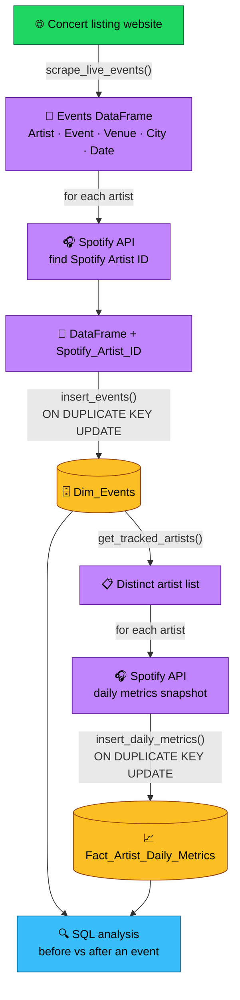
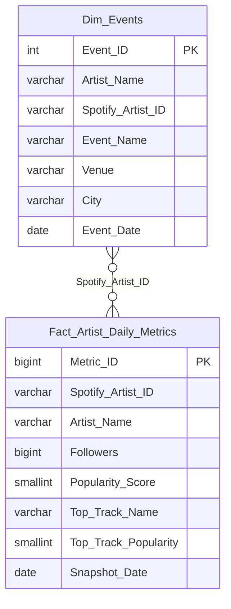

# 🎧 Live Event Impact ETL Pipeline

### 🎤 Do live concerts move an artist's streaming numbers?

**🌐 Scrape  ➜  🎧 Enrich  ➜  🗄️ Store  ➜  📈 Track  ➜  🔍 Analyze**

🐍 Python &nbsp;·&nbsp; 🐼 Pandas &nbsp;·&nbsp; 🎧 Spotify Web API &nbsp;·&nbsp; 🌐 Web Scraping &nbsp;·&nbsp; 🐬 MySQL &nbsp;·&nbsp; 📜 MIT License

| 1️⃣ EXTRACT | 2️⃣ ENRICH | 3️⃣ LOAD | 4️⃣ TRACK |
|:---:|:---:|:---:|:---:|
| 🌐 Scrape live concert events | 🎧 Match artists on Spotify | 🗄️ Store in MySQL tables | 📈 Daily artist snapshots |

**🧭 Jump to:**
[🎯 Overview](#overview) ·
[🏗️ Flowchart](#architecture) ·
[⚙️ Steps](#stages) ·
[🗄️ Data model](#datamodel) ·
[🚀 Run it](#setup) ·
[⚠️ API change](#apichange) ·
[🛠️ Troubleshooting](#trouble) ·
[🗺️ Roadmap](#roadmap)

</div>

---

<a id="overview"></a>

## 🎯 Overview

### 🎯 The idea

When a big artist plays a city, does anything change online? More listeners, more followers, more attention? Answering that needs two kinds of data that live in different places:

| 🎟️ What we need | 📍 Where it lives |
|---|---|
| **When and where** artists perform | Public concert-listing web pages |
| **How popular** the artist is, day by day | Streaming-platform data (Spotify) |

This project is an automated **ETL pipeline** (Extract → Transform/Enrich → Load) that collects both, links them through the artist, and stores everything in a **MySQL** database designed for time-series analysis.

### ✨ What it does

- 🌐 **Scrapes** upcoming live events (artist, event name, venue, city, date) into a Pandas DataFrame
- 🎧 **Enriches** each event with the artist's **Spotify Artist ID**
- 🗄️ **Loads** events into a dimension table without creating duplicates on re-runs
- 📅 **Takes a daily snapshot** of metrics for every tracked artist and stores it in a fact table
- 🔁 **Is safe to run repeatedly**, so it can be scheduled to run every day

> [!NOTE]
> The data model follows a simple **star-schema** idea: a dimension table describes *things* (events), and a fact table records *measurements over time* (daily artist metrics).

---

<a id="architecture"></a>

## 🏗️ Architecture & Flowchart

### 🔄 Flowchart



> 🟢 source &nbsp;·&nbsp; 🟣 processing &nbsp;·&nbsp; 🟡 database &nbsp;·&nbsp; 🔵 analysis

### 📝 Same flow in plain text

```text
 +------------------------------+
 |   Concert listing website    |
 +--------------+---------------+
                | scrape_live_events()
                v
 +------------------------------+
 |   Events DataFrame           |
 |   Artist, Event, Venue,      |
 |   City, Date                 |
 +--------------+---------------+
                | for each artist
                v
 +------------------------------+
 |   Spotify API                |
 |   find Spotify Artist ID     |
 +--------------+---------------+
                | adds Spotify_Artist_ID column
                v
 +------------------------------+
 |   insert_events()            |------>  [ Dim_Events ]
 |   ON DUPLICATE KEY UPDATE    |                |
 +------------------------------+                | get_tracked_artists()
                                                 v
                                   +------------------------------+
                                   |   Distinct artist list       |
                                   +--------------+---------------+
                                                  | for each artist
                                                  v
                                   +------------------------------+
                                   |   Spotify API                |
                                   |   daily metrics snapshot     |
                                   +--------------+---------------+
                                                  |
                                                  v
                                   +------------------------------+
                                   |   insert_daily_metrics()     |---->  [ Fact_Artist_Daily_Metrics ]
                                   |   ON DUPLICATE KEY UPDATE    |
                                   +------------------------------+

            Dim_Events + Fact_Artist_Daily_Metrics  -->  SQL analysis (before vs after an event)
```

---

<a id="stages"></a>

## ⚙️ The pipeline, step by step

Everything is orchestrated by `run_etl_pipeline()` in `main.py`. Three small modules do the real work:

| 🧩 Module | 🎯 Responsibility |
|---|---|
| `scraper.py` | Extracts live events from the web into a DataFrame |
| `spotify_client.py` | `SpotifyEnricher` class: talks to the Spotify API for artist IDs and metrics |
| `database.py` | `DatabaseManager` class: all MySQL reads and writes |
| `config.py` | Credentials and connection settings (**never commit real values**) |

### 1️⃣ Initialise clients
`SpotifyEnricher()` authenticates with Spotify and `DatabaseManager()` opens the MySQL connection using `MYSQL_CONFIG`. If either fails, the pipeline stops immediately instead of half-running.

### 2️⃣ Extract: scrape live events
`scrape_live_events()` downloads the concert listing pages and returns a DataFrame with these columns:

`Artist_Name` · `Event_Name` · `Venue` · `City` · `Event_Date`

### 3️⃣ Enrich: attach Spotify artist IDs
For every artist in the DataFrame the pipeline asks Spotify for the artist and keeps the **Spotify Artist ID** (or `None` if no match is found). The IDs are added as a new column, `Spotify_Artist_ID`.

> 💡 **Why an ID and not just the name?** Names are ambiguous and can be spelled differently. The ID is a stable key, which makes later joins between events and daily metrics reliable.

### 4️⃣ Load: write events to `Dim_Events`
`insert_events()` loops over the DataFrame and runs an `INSERT ... ON DUPLICATE KEY UPDATE`:

- A **new** event is inserted
- An event that **already exists** (same artist, city and date) is **updated** (event name and venue) instead of duplicated

This is called an **idempotent load**: running the pipeline ten times gives the same result as running it once.

### 5️⃣ Track: build the daily snapshot
`get_tracked_artists()` reads the distinct artists from `Dim_Events`. For each one, the pipeline requests fresh metrics from Spotify. Artists whose lookup fails are skipped, so one bad record never stops the run.

### 6️⃣ Load: write metrics to `Fact_Artist_Daily_Metrics`
`insert_daily_metrics()` stores one row per artist per day, again with `ON DUPLICATE KEY UPDATE`, so re-running on the same day refreshes that day's row instead of duplicating it. Run daily, this builds a **time series** you can compare against event dates.

### 7️⃣ Clean up
The database connection is closed and a completion message is printed.

---

<a id="datamodel"></a>

## 🗄️ Data model



### 🗓️ `Dim_Events`: one row per concert

| Column | Type | Meaning |
|---|---|---|
| `Event_ID` | INT, auto-increment | Primary key |
| `Artist_Name` | VARCHAR | Performing artist |
| `Spotify_Artist_ID` | VARCHAR, nullable | Link to Spotify (null if no match) |
| `Event_Name` | VARCHAR | Title of the show |
| `Venue` | VARCHAR | Venue name |
| `City` | VARCHAR | City |
| `Event_Date` | DATE | Concert date |

🔑 **Unique key:** `(Artist_Name, City, Event_Date)`. This is what makes the upsert work.

### 📈 `Fact_Artist_Daily_Metrics`: one row per artist per day

| Column | Type | Meaning |
|---|---|---|
| `Metric_ID` | BIGINT, auto-increment | Primary key |
| `Spotify_Artist_ID` | VARCHAR | Artist key |
| `Artist_Name` | VARCHAR | Artist |
| `Followers` | BIGINT | Follower count on that day |
| `Popularity_Score` | SMALLINT | Platform popularity score |
| `Top_Track_Name` | VARCHAR | The artist's top track that day |
| `Top_Track_Popularity` | SMALLINT | That track's popularity |
| `Snapshot_Date` | DATE | Day the snapshot was taken |

🔑 **Unique key:** `(Spotify_Artist_ID, Snapshot_Date)`.

> [!IMPORTANT]
> The `ON DUPLICATE KEY UPDATE` logic **only works if these unique keys exist**. Without them, every run would insert duplicate rows. The table definitions are in `setup_database.sql`.

### 🔍 Example analysis query

Once metrics are collected, this compares each artist's average followers in the **7 days before** a concert with the **7 days from the event date onward**:

```sql
SELECT  e.Artist_Name, e.City, e.Event_Date,
        AVG(CASE WHEN f.Snapshot_Date BETWEEN DATE_SUB(e.Event_Date, INTERVAL 7 DAY)
                                          AND DATE_SUB(e.Event_Date, INTERVAL 1 DAY)
                 THEN f.Followers END) AS avg_followers_before,
        AVG(CASE WHEN f.Snapshot_Date BETWEEN e.Event_Date
                                          AND DATE_ADD(e.Event_Date, INTERVAL 7 DAY)
                 THEN f.Followers END) AS avg_followers_after
FROM    Dim_Events e
JOIN    Fact_Artist_Daily_Metrics f ON f.Spotify_Artist_ID = e.Spotify_Artist_ID
GROUP BY e.Event_ID, e.Artist_Name, e.City, e.Event_Date;
```

---

<a id="stack"></a>

## 🧰 Tech stack

| 🧰 Tool | 🎯 Used for |
|---|---|
| **Python 3.9+** | Pipeline logic and orchestration |
| **Requests / HTML parsing** | Fetching and reading concert listing pages |
| **Pandas** | Holding and reshaping event data |
| **Spotify Web API** | Artist lookup and metrics |
| **MySQL 8 + `mysql-connector-python`** | Storage and upserts |
| **MySQL Workbench** | Creating the database and checking results |

---

<a id="setup"></a>

## 🚀 Setup and run

### 1️⃣ Clone the repository

```bash
https://github.com/Nameis-nilesh/Live-Event-Impact-ETL-Pipeline
cd Live-Event-Impact-ETL-Pipeline/Spotify
```

### 2️⃣ Create a virtual environment *(recommended)*

```bash
python -m venv venv
source venv/bin/activate        # macOS / Linux
venv\Scripts\activate           # Windows
```

### 3️⃣ Install dependencies

```bash
pip install pandas requests beautifulsoup4 mysql-connector-python
```

> ✏️ Add any other libraries your `scraper.py` and `spotify_client.py` import, and consider committing a `requirements.txt`.

### 4️⃣ Create the MySQL database

Open **MySQL Workbench**, connect as an admin user, and run `setup_database.sql`. It creates:

- the `spotify` database
- a dedicated `etl_user` with access to only that database
- both tables, with their unique keys

Remember to change the placeholder password in the script first.

### 5️⃣ Get Spotify credentials

1. Go to the [Spotify Developer Dashboard](https://developer.spotify.com/dashboard) and create an app
2. Copy the **Client ID** and **Client Secret**

### 6️⃣ Configure the project

Copy the template and fill in your own values:

```bash
cp config.example.py config.py      # Windows: copy config.example.py config.py
```

```python
# config.py  (never commit this file)
SPOTIFY_CLIENT_ID = "your_client_id"
SPOTIFY_CLIENT_SECRET = "your_client_secret"

MYSQL_CONFIG = {
    "host": "localhost",
    "database": "spotify",
    "user": "etl_user",
    "password": "your_password",
}
```

### 7️⃣ Test the database connection

```bash
python test_connection.py
```

You should see `CONNECTED` and both tables listed.

### 8️⃣ Run the pipeline

```bash
python main.py
```

> [!TIP]
> Running from Jupyter? **Restart the kernel after editing `config.py`.** Python caches imported modules, so edits are ignored until you restart.

---

<a id="output"></a>

## 📺 What a run looks like

A successful database step looks like this:

```text
--- Starting Live Event Impact ETL: 2026-11-03 20:40:38 ---
[Database] Processed 4 event records into MySQL.
[Database] Logged daily Spotify metrics for 4 artists into MySQL.
--- ETL Pipeline Execution Complete ---
```

Quick checks in Workbench:

```sql
SELECT * FROM Dim_Events ORDER BY Event_Date;
SELECT * FROM Fact_Artist_Daily_Metrics ORDER BY Snapshot_Date DESC;
```

---

<a id="apichange"></a>

## ⚠️ Important: Spotify API change

> [!WARNING]
> **Spotify removed some artist fields in 2026.** According to Spotify's [February 2026 migration guide](https://developer.spotify.com/documentation/web-api/tutorials/february-2026-migration-guide), apps in **Development Mode** no longer receive artist `followers` and `popularity` (or track `popularity`), and some endpoints such as artist top tracks were removed.

**What this means for this project**

| ✅ Still works | ❌ Affected |
|---|---|
| Web scraping of events | `Followers` |
| Writing events to MySQL | `Popularity_Score` |
| Artist ID lookup (search) | `Top_Track_Popularity` |
| Upsert and idempotency logic | Top-track lookup |

If these fields are missing, the metrics step logs an error such as `Failed to fetch data for <artist>: 'followers'` and writes **0 snapshot rows**. The database and event-loading steps are unaffected.

**Planned fix:** keep Spotify for artist identity and move the "attention" metrics to sources that are still open. See the [Roadmap](#roadmap).

---

<a id="trouble"></a>

## 🛠️ Troubleshooting

| 🚨 Symptom | 🔎 Likely cause | 🔧 Fix |
|---|---|---|
| `1045 Access denied for user` | Wrong username or password in `config.py` | Use the `etl_user` credentials from the setup script; restart the kernel |
| `2003 Can't connect to MySQL server` | MySQL service not running or wrong port | Start the MySQL service; check host and port |
| `1049 Unknown database` | Database not created yet | Run `setup_database.sql` |
| Edits to `config.py` ignored | Jupyter cached the old module | Kernel → Restart |
| Duplicate rows after re-runs | Unique keys missing | Recreate tables using `setup_database.sql` |
| `KeyError: 'followers'` | Spotify no longer returns the field | See [Spotify API change](#apichange) |
| Event date rejected | Date not in `YYYY-MM-DD` form | Convert with `pd.to_datetime(...).dt.date` before inserting |

---

<a id="security"></a>

## 🔐 Security notes

- 🔐 **Never commit `config.py`.** Add it to `.gitignore` and commit only `config.example.py` with fake values
- 👤 Use the **dedicated `etl_user`**, not `root`, so the pipeline can only touch its own database
- ♻️ If a password or Spotify secret was ever pushed to GitHub, **rotate it**. Deleting the file later does not remove it from Git history

```text
# .gitignore
config.py
.env
__pycache__/
*.pyc
```

---

<a id="roadmap"></a>

## 🗺️ Roadmap

- [ ] 🔄 **Replace removed Spotify metrics** with open sources: Wikipedia daily page views, Last.fm listener counts, or YouTube channel statistics
- [ ] ⏰ **Schedule daily runs** (Windows Task Scheduler, cron or GitHub Actions) to build the time series
- [ ] 🪵 Replace `print` with the `logging` module and add retries with back-off for API calls
- [ ] 🧪 Add unit tests for the scraper parsing and database upserts
- [ ] ⚡ Use `executemany` for faster batch inserts
- [ ] 📊 Build a **Power BI / Tableau dashboard** showing metrics around event dates
- [ ] 📈 Add an analysis notebook: before vs after comparison with significance testing
- [ ] 🐳 Add a Docker Compose file for one-command MySQL setup
- [ ] 🧾 Commit `requirements.txt` and `setup_database.sql`

---

<a id="skills"></a>

## 🧩 Skills demonstrated

| 🧩 Area | 🛠️ Detail |
|---|---|
| **ETL design** | End-to-end Extract, Enrich, Load pipeline with clear stages |
| **Web scraping** | Turning web pages into structured DataFrames |
| **API integration** | Authenticated Spotify API calls with graceful failure handling |
| **Database design** | Dimension and fact tables, unique keys, time-series snapshots |
| **Idempotent loading** | `ON DUPLICATE KEY UPDATE` so re-runs never create duplicates |
| **Code structure** | Separate modules for scraping, enrichment and storage |
| **Security hygiene** | Dedicated DB user, secrets kept out of Git |
| **Problem solving** | Diagnosed an upstream API change and planned a migration |

---

<a id="author"></a>

## 👤 Author

<div align="center">

**Nilesh Yadav* · 📊 Data Analytics Portfolio Project

🔗 https://github.com/Nameis-nilesh

Distributed under the **MIT License**

⭐ If you found this project useful, consider giving it a star!

</div>
